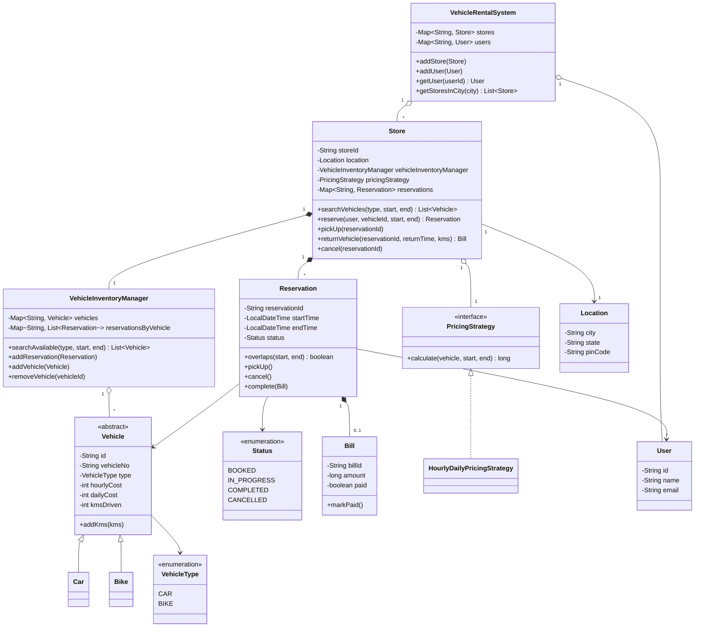

# Car Rental – Class Diagram

## Legend
| Arrow | Meaning | Example |
|---|---|---|
| `<\|--` | **Is-a** (extends) | `Car` is a `Vehicle` |
| `<\|..` | **Is-a** (implements) | `HourlyDailyPricingStrategy` is a `PricingStrategy` |
| `*--` | **Has-a, composition**: the part is created and owned by the whole | `Store` creates its `VehicleInventoryManager` |
| `o--` | **Has-a, aggregation**: the part exists on its own | `VehicleRentalSystem` holds `Store`s |
| `-->` | **Uses / refers to** | `Reservation` refers to a `User` |

## Diagram

## Relationships in plain words
**Is-a**
- `Car` and `Bike` are `Vehicle`s. `Vehicle` is abstract, so only concrete types are created.
- `HourlyDailyPricingStrategy` is a `PricingStrategy`. New pricing rules are added as new implementations.

**Has-a**
- `VehicleRentalSystem` has many `Store`s and `User`s. They are created outside and registered, so this is aggregation.
- `Store` creates and owns its `VehicleInventoryManager` and its `Reservation`s (composition).
- `Store` has a `PricingStrategy` passed in through the constructor (aggregation, dependency injection).
- `VehicleInventoryManager` has many `Vehicle`s, which can be added or removed.
- A `Reservation` gets one `Bill` when the vehicle is returned (0 or 1).

**Uses**
- A `Reservation` refers to a `User` and a `Vehicle` that exist independently of it.

