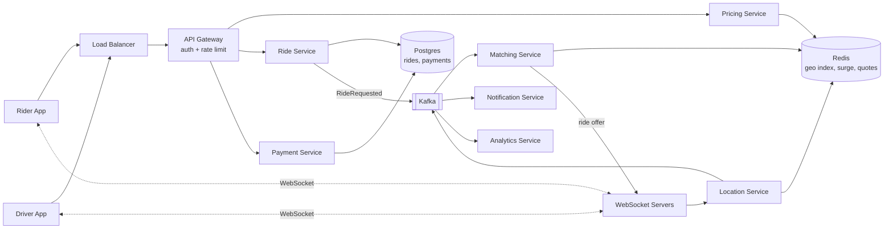
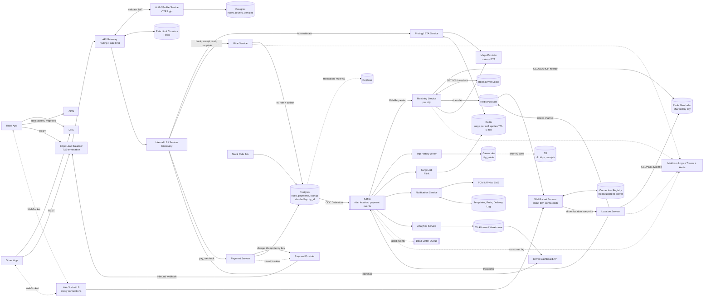

# Cab Aggregator (HLD)

**Terms:** **Rider** = passenger who books. **Driver** = person driving the cab.

## 1. Requirements and Scope
**Functional**
- Rider enters pickup and drop, sees fare and ETA per vehicle type, and books a ride
- System matches the ride to a nearby driver (no driver gets two rides, no ride gets two drivers)
- Live tracking of the driver before pickup and during the ride
- Pay after the ride (cash, UPI, card, wallet)
- Rider and driver rate each other
- (Good to have) Share live trip with family, driver earnings dashboard

**Out of scope:** scheduled rides, pooling, driver onboarding/KYC, in-app chat, support tickets.

**Non-functional**
- Matching latency: driver assigned in < 10 s (p95). Fare estimate p99 < 300 ms
- Location freshness: driver position on rider's map is < 5 s old
- Availability: 99.99% for booking and tracking
- Consistency: **strong** for ride assignment and payments. **Eventual** for locations, ratings, analytics
- Durability: no completed ride or payment is ever lost
- Scale: handle peak hours (3x) and spikes (rain, events)

## 2. Estimates
- Riders: 100M total, 10M DAU. Drivers: 2M total, 1M daily active, 500K online at peak
- Rides: 10M/day = about 115 rides/sec. Peak (3x): about 350 rides/sec
- **Driver location updates (the biggest load):** 500K drivers x 1 update / 4 s = **125K writes/sec**
- Live location store: 1M drivers x 100 B = about 100 MB, so it fits in memory (Redis)
- Ride records: 10M/day x 1 KB = 10 GB/day, about 3.6 TB/year, about 18 TB over 5 years
- Trip path history: 20 min ride / 4 s = 300 points x 50 B = 15 KB per ride. 10M x 15 KB = 150 GB/day. Move to S3 after 90 days
- Location bandwidth: 125K/sec x 100 B = about 12.5 MB/sec inbound
- Concurrent WebSocket connections: about 500K drivers + about 1M riders at peak

## 3. Core Entities and API
**Entities:** Rider, Driver, Vehicle, Ride, Payment, Rating, FareQuote, LocationPoint.
- Rider 1..N Ride. Driver 1..N Ride. Driver 1..1 Vehicle (active). Ride 1..1 Payment. Ride 1..2 Rating.

**Rider APIs (REST)**
- `POST /v1/fare-estimates` body `{pickup, drop}` returns `[{vehicleType, fare, eta, quoteId}]`. Quote is valid for 5 min.
- `POST /v1/rides` body `{quoteId, paymentMethod}`, header `Idempotency-Key`. Returns `201 {rideId, status: MATCHING}`.
- `GET /v1/rides/{id}` returns status, driver, vehicle, OTP (only for the rider).
- `POST /v1/rides/{id}/cancel`
- `POST /v1/rides/{id}/payment` body `{method}`, header `Idempotency-Key`.
- `POST /v1/rides/{id}/rating` body `{score, comment}` (used by both sides; role comes from the token).
- `POST /v1/rides/{id}/share` returns a read-only tracking link with expiry.

**Driver APIs (REST)**
- `PUT /v1/drivers/me/status` body `{ONLINE | OFFLINE}`
- `POST /v1/rides/{id}/accept` returns `200` if won, `409` if another driver already got it.
- `POST /v1/rides/{id}/arrived`, `POST /v1/rides/{id}/start` body `{otp}`, `POST /v1/rides/{id}/complete`
- `GET /v1/drivers/me/earnings?from=&to=&cursor=` (cursor pagination)

**Real-time (WebSocket)**
- Driver sends `{lat, lng, heading, ts}` every 4 s. Driver receives ride offers.
- Rider subscribes to `ride:{id}` and receives driver location and status changes.
- Why WebSocket: two-way, low overhead per message. Fall back to push notification (FCM/APNs) if the app is in the background.

**Inbound webhook:** `POST /v1/webhooks/psp` from the payment provider (verify signature, dedupe by event ID).

**Auth and rate limiting**
- OTP login on mobile, then a short-lived JWT plus a refresh token. Roles: RIDER, DRIVER, ADMIN.
- Rate limit at the gateway with a token bucket per user: for example 10 ride requests/min, 30 fare estimates/min.

## 4. Architecture
See the diagrams at the end.

**Write flow: book a ride**
1. Rider calls `POST /v1/fare-estimates`. Pricing service reads surge for the pickup area and gets ETA from the maps provider. Stores the quote in Redis (TTL 5 min).
2. Rider calls `POST /v1/rides` with `quoteId`. Ride service inserts a ride with status `MATCHING` in Postgres and writes a `RideRequested` event to the outbox table in the same transaction.
3. Matching service consumes the event and queries the geo index for available drivers near the pickup.
4. It ranks them (distance/ETA, rating, acceptance rate) and sends an offer to the top driver(s) over WebSocket, with a 15 s timeout.
5. Driver calls `/accept`. Ride service does a conditional update (see Concurrency). First accept wins, others get `409`.
6. Rider gets the driver details and OTP over WebSocket. Notification service sends a push as backup.

**Read flow: live tracking**
1. Driver app sends location over WebSocket every 4 s.
2. Location service updates the geo index in Redis and the driver's last position.
3. If the driver is on a ride, it publishes the point to the `ride:{id}` channel (Redis Pub/Sub) and to Kafka for trip history.
4. The WebSocket server holding the rider's connection pushes the point to the rider app.

**Trip end flow**
1. Driver calls `/complete`. Ride service computes the final fare from the actual distance and time, sets status `COMPLETED`.
2. Payment service charges the rider (or marks cash collected). Status becomes `PAID`.
3. Events go to Kafka for receipts, ratings prompt, driver earnings, and analytics.

## 5. Data Model, DB Choice, Indexes
**DB choice by access pattern**
| Data | Store | Why |
|---|---|---|
| Live driver locations, geo index | **Redis** (GEO commands) | 125K writes/sec, only latest value needed, in-memory |
| Riders, drivers, vehicles, rides, payments, ratings | **Postgres**, sharded by `city_id` | Relations, transactions, strong consistency for assignment and money |
| Trip path history | **Cassandra** | Huge append-only time-series, read by `ride_id` |
| Fare quotes, surge per area, driver locks | **Redis** with TTL | Short-lived, fast |
| Receipts, old trip paths | **S3** | Cheap long-term storage |
| Analytics | **ClickHouse / warehouse** | Aggregations for dashboards |

Why shard by `city_id`: almost every query (matching, surge, active rides) stays inside one city, so there are no cross-shard queries on the hot path.

**Table `rides`**
| Column | Type | Notes |
|---|---|---|
| ride_id | bigint | **PK**, Snowflake ID (sortable, no coordination) |
| city_id | int | shard key |
| rider_id | bigint | FK riders |
| driver_id | bigint | FK drivers, null until accepted |
| status | enum | REQUESTED, MATCHING, ACCEPTED, ARRIVED, IN_PROGRESS, COMPLETED, PAID, CANCELLED |
| pickup, drop | lat/lng | |
| quote_id, quoted_fare, final_fare | | quoted fare locked at booking |
| otp | string | shown to rider, checked at start |
| version | int | for optimistic locking |
| created_at, started_at, completed_at | timestamp | |

**Table `payments`**
| Column | Type | Notes |
|---|---|---|
| payment_id | bigint | **PK** |
| ride_id | bigint | **unique**, one payment per ride |
| method | enum | CASH, UPI, CARD, WALLET |
| amount, currency | decimal, string | never float for money |
| status | enum | PENDING, SUCCESS, FAILED, REFUNDED |
| idempotency_key | string | **unique** |
| psp_txn_id | string | ID from the payment provider |

**Other tables:** `riders (rider_id, name, phone, rating_avg, ...)`, `drivers (driver_id, name, phone, city_id, status, rating_avg, ...)`, `vehicles (vehicle_id, driver_id, number, type, ...)`, `ratings (ride_id, rater_role, score, comment)`.

**Cassandra `trip_points`:** partition key `ride_id`, clustering key `ts`. One read returns the full path in order.

**Indexes**
- `rides (rider_id, created_at DESC)` serves rider trip history.
- `rides (driver_id, created_at DESC)` serves driver earnings dashboard.
- Partial index `rides (status) WHERE status NOT IN ('PAID','CANCELLED')` serves "active rides" and stuck-ride jobs.
- `payments (ride_id)` unique and `payments (idempotency_key)` unique: block double charges.
- `ratings (ride_id, rater_role)` unique: one rating per side per ride.
- Each index slows writes a little. Rides are about 350 writes/sec at peak, so this is fine.

**ACID**
- Ride assignment: single-row conditional update in Postgres (atomic).
- Payment record + ride status `PAID`: same shard, so one local transaction.
- Locations: no transactions. Losing one point is fine because the next one comes in 4 s.

**Data lifecycle:** trip points to S3 after 90 days. Rides and payments kept 7 years (tax/legal), then archived. On account deletion, anonymize rider PII but keep payment records.

## 6. Deep Dives
### Geo Index and Matching (the key design choice)
| Option | Pros | Cons |
|---|---|---|
| SQL query on lat/lng ranges | Simple | Too slow at 125K writes/sec |
| Quadtree in memory | Adapts to density | Hard to update this often, custom code |
| **Geohash / H3 cells in Redis (chosen)** | Fast updates, simple radius search, built into Redis | Cell edges need neighbor lookups |

- Each driver location update: `GEOADD drivers:{city}:{vehicleType} lng lat driverId`. Only `AVAILABLE` drivers are in this set.
- Search: `GEOSEARCH ... FROMLONLAT lng lat BYRADIUS 3 km ASC COUNT 20`. If too few results, widen to 5 km, then 8 km.
- Stale drivers: keep `driver:{id}:last_seen`. Remove drivers with no update in 30 s.
- Ranking: ETA from maps provider for top 20, then score by ETA, rating, acceptance rate.
- Offer strategy: send to the best driver with a 15 s timeout, then the next. In busy areas, send to the top 3 at once and let the first accept win.

### Concurrency (no double booking)
Two races: two drivers accept the same ride, and one driver gets two rides at once.
- **Ride side (optimistic, in DB):**
  `UPDATE rides SET driver_id = :d, status = 'ACCEPTED', version = version + 1 WHERE ride_id = :r AND status = 'MATCHING'`
  If 0 rows updated, someone else won, so return `409`.
- **Driver side (lock in Redis):** before offering, `SET driver:{id}:lock {rideId} NX EX 20`. Only one ride can hold a driver. Remove the driver from the geo set while locked.
- Why optimistic here: conflicts are rare and short. Pessimistic row locks would hold DB connections while waiting for a human to tap "accept".
- Why not 2PC/3PC: blocking and fragile when the coordinator fails. A single-row conditional update is enough.
- Idempotency: `POST /rides` and `POST /payment` take an `Idempotency-Key`, so retries do not create a second ride or charge.

### Pricing and Surge
- Fare = (base + per_km x distance + per_min x time) x surge.
- Surge per H3 cell = open requests / available drivers, computed every 1 min by a stream job (Flink) on Kafka events. Stored in Redis.
- Quote is locked at booking with `quoteId` (TTL 5 min), so the rider pays what they saw unless the route changes a lot.

### Cache
- Fare quotes, surge, driver locks, driver profile (name, vehicle, rating) in Redis.
- Driver profile: cache-aside, TTL 10 min, invalidate on profile update.
- Write-around for rides: active ride state is read from Postgres primary to avoid stale status.
- Hot key: surge for a busy cell during events. Mitigate with a small in-process cache (1-2 s TTL) on Pricing servers.

### Scalability
- Shard Postgres and Redis by `city_id`. Very large cities can be split into zones.
- Location service and WebSocket servers are stateless; a connection registry in Redis maps `userId -> ws server`.
- Matching service runs per city, so each instance works on a small geo set.
- Load shedding at peak: drop fare-estimate refreshes before ride requests.

### Consistency and CAP
- **CP:** ride assignment and payments. Better to fail a request than to double book or double charge.
- **AP:** locations, ETA, surge, ratings. A few seconds of staleness is fine.
- PACELC: with no partition, locations choose low latency over consistency.
- Read-your-writes: after booking, rider reads ride status from the primary.

### Distributed Transactions (trip end saga)
1. Ride service: `COMPLETED`, final fare saved, `RideCompleted` written to outbox in the same transaction.
2. Payment service: charges via payment provider with the idempotency key.
3. On success: ride `PAID`, driver earnings credited, receipt sent.
4. On failure: retry with backoff. After N failures, mark as dues on the rider account (compensation) and allow cash later. The driver is still paid.
- **Outbox + CDC (Debezium):** ride events go from the outbox table to Kafka, so a DB write and a Kafka publish can never get out of sync.

### Real-time
- WebSocket servers hold about 50K connections each, so about 30 servers at peak.
- Connection registry in Redis: `user:{id} -> ws-server-7`. Server-to-server delivery via Redis Pub/Sub on `ride:{id}`.
- Reconnect: app reconnects with backoff and fetches current ride state with `GET /v1/rides/{id}`.
- Share trip: a read-only token subscribes to the same `ride:{id}` channel.

## 7. Async Flows
- **Kafka topics:** `ride-events`, `location-points`, `payment-events`. Key by `ride_id` to keep order per ride. At-least-once delivery, so consumers dedupe by event ID. DLQ for poison messages.
- **Notification service:** push (FCM/APNs) for driver assigned, driver arrived, receipt. SMS fallback for OTP and safety alerts. Templates, user preferences, dedupe by `(ride_id, event_type)`.
- **Analytics service:** consumes all topics into ClickHouse. Powers driver earnings dashboard (trips, money today/week/month), city heatmaps, surge tuning.
- **Webhooks:** inbound only, from the payment provider. Verify HMAC signature, dedupe by provider event ID, return `2xx` fast, process async.

## 8. Failures and Monitoring
- **Redis geo node down:** replica takes over. Drivers resend location within 4 s, so the index rebuilds itself.
- **Matching service down:** rides stay `MATCHING`. Another instance picks up from Kafka (consumer group).
- **No driver accepts:** widen radius, retry for up to 2 min, then cancel and notify the rider. No charge.
- **Driver app loses network mid-ride:** ride continues; final fare uses the last known points plus the planned route.
- **Payment provider down:** circuit breaker. Mark payment `PENDING`, let the trip end, retry later.
- **Stuck rides:** a background job finds rides in one status too long (for example `ACCEPTED` > 30 min) and alerts or cancels them.
- **Multi-region:** active-active per city group. A city's data lives in one home region, with async replication to a standby region. RPO < 1 min, RTO < 5 min.
- **Retries:** exponential backoff with jitter. All writes are idempotent.
- **Metrics:** match time p50/p95, match success rate, location update lag, WebSocket connection count, fare-estimate p99, payment success rate, Kafka consumer lag, Redis memory.
- **Alerts:** match success rate drop in a city, payment failure spike, consumer lag growth.
- **Security:** TLS everywhere, encrypt PII at rest, mask phone numbers (call through a proxy number), OTP to start a ride, SOS button sends location to emergency contacts.

## 9. Operations
- Deploy with **canary per city**: release to one small city first, watch match rate and errors, then roll out. Feature flags for pricing changes.
- Schema changes: expand then contract (add column, backfill, switch reads, drop old column).
- Cost: Redis for live data only. Trip paths go to S3 after 90 days. Analytics on cheaper columnar storage.

## 10. Trade-offs and Future Work
- **Redis geo vs quadtree:** Redis is simpler and fast enough. A quadtree adapts better to dense areas but needs custom code.
- **Postgres vs NoSQL for rides:** Postgres gives safe assignment and payments. NoSQL would scale writes more easily but makes "no double booking" harder.
- **Optimistic vs pessimistic locking:** optimistic, because conflicts are rare and drivers take seconds to respond.
- **Send offer to 1 driver vs many:** one at a time is fair but slower. Many at once is faster but more drivers see offers they lose.
- **First bottleneck at 10x:** location writes (1.25M/sec) and WebSocket fan-out. Fix by splitting Redis per city zone, batching location updates, and sending fewer points when the driver is idle.
- **Future:** pooling, scheduled rides, ML-based ETA and dispatch, driver heatmaps for supply positioning.

## Diagram

## Full Design Diagram (All Components)

