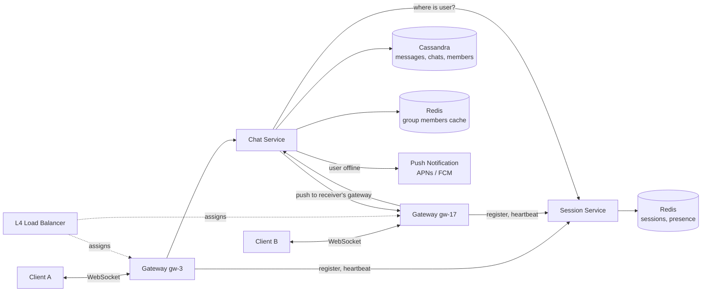

# Chat Application like WhatsApp (HLD, interview version)

**Core idea:** every online device keeps one long-lived connection to a **Gateway** server. A **Session service** remembers which gateway each user is connected to. To deliver a message, the Chat service saves it, asks the Session service where the receiver is, and pushes it to that gateway. Offline users get it later by syncing from the DB.

**Terms:** **Gateway** = stateful server holding open WebSocket/TCP connections (about 50K-100K each). **Session** = `user -> gateway` mapping. **seq** = per-chat increasing number that orders messages. **Receipt** = delivered / read status sent back to the sender.

## 1. Requirements
**Functional**
- 1:1 messages and group messages (groups up to 500 members)
- Message status: sent (1 tick), delivered (2 ticks), read (blue ticks)
- Online / last seen
- Offline users receive messages when they reconnect; chat history on any device

**Out of scope:** voice/video calls, end-to-end encryption details, media (would use presigned S3 URLs), stories.

**Non-functional**
- Delivery latency p99 < 500 ms when both users are online
- No message is lost; no duplicates shown; order kept within a chat
- 99.99% available; presence/last seen can be slightly stale (eventual)

## 2. Estimates
- 500M DAU x 40 messages/day = 20B/day = about **230K messages/sec**, peak about 700K/sec
- Message about 200 B: 20B x 200 B = **4 TB/day**, so a write-heavy, horizontally scaled store
- 100M concurrent connections / 50K per gateway = about **2,000 gateways**
- Receipts: about 2 per message (delivered + read), so more receipt traffic than message traffic

## 3. API
**Over the connection (WebSocket frames)**
- Client sends `{type: SEND, clientMsgId, chatId, text}`
- Server acks sender `{type: ACK, clientMsgId, msgId, seq}` (1 tick)
- Server pushes to receiver `{type: MSG, chatId, msgId, seq, senderId, text, sentAt}`
- Client sends `{type: RECEIPT, chatId, upToSeq, status: DELIVERED | READ}`; server forwards it to the sender
- Server pushes `{type: PRESENCE, userId, online, lastSeen}` for the chat that is open
- `{type: PING}` every 30 s (heartbeat)

**REST**
- `GET /v1/chats?cursor=` chat list sorted by last activity
- `GET /v1/chats/{chatId}/messages?afterSeq=&limit=` sync / history
- `POST /v1/groups` body `{name, memberIds[]}`; `POST /v1/groups/{id}/members`

Why WebSocket: the server must push to the client instantly. Polling wastes battery and adds delay.

## 4. Flows
**Connect**
1. Client -> L4 load balancer -> any Gateway. Gateway checks the JWT.
2. Gateway writes the session: `session:{userId}:{deviceId} = gw-17`, TTL 60 s, refreshed by heartbeats.
3. Gateway marks the user online in presence. Client syncs missed messages with `GET /messages?afterSeq=<last seq it has>` per chat.

**1:1 message: Alice -> Bob**
1. Alice's gateway (`gw-3`) forwards `SEND` to the **Chat service**.
2. Chat service dedupes by `clientMsgId`, gets the next `seq` for the chat, saves the message in **Cassandra**, and acks Alice (1 tick).
3. Chat service asks the **Session service** where Bob is: `gw-17`.
4. Chat service sends the message to `gw-17` (gRPC), which pushes it to Bob's connection.
5. Bob's app sends `RECEIPT DELIVERED`. It goes `gw-17 -> Chat service`, which updates `chat_members` and forwards it to Alice's gateway (2 ticks).
6. **Bob offline** (no session): message is already saved; send a push notification (APNs / FCM). Bob gets it on reconnect sync.

**Group message (Alice -> group of 50)**
1. Same as steps 1-2: **one** copy of the message is stored per group, not one per member.
2. Chat service loads the member list (cached in Redis), looks up all sessions in one batch, groups members by gateway, and sends **one call per gateway** with the list of receivers.
3. Offline members get a push notification and sync later.

## 5. Data Model
| Data | Store | Why |
|---|---|---|
| Messages | **Cassandra** | Huge write rate, read by `chat_id` in seq order |
| Chats, members, receipt positions | **Cassandra** (or sharded Postgres) | Access by chat / by user |
| Sessions (`user -> gateway`) | **Redis** with TTL | Fast lookups, short-lived |
| Presence / last seen | **Redis** | Changes constantly |

- `messages (chat_id, seq, msg_id, sender_id, text, sent_at)` partition `chat_id`, clustering `seq DESC`. For very active chats, partition by `(chat_id, month)` to keep partitions small.
- `chats (chat_id PK, type DIRECT | GROUP, name, last_seq)`. 1:1 chat ID = hash of the two sorted user IDs, so both users always land on the same chat.
- `chat_members (chat_id, user_id, last_delivered_seq, last_read_seq, role)`
- `user_chats (user_id, last_activity, chat_id)`: chat list for the home screen
- `msg_id`: Snowflake (sortable, generated without coordination). `seq`: per chat, from `chats.last_seq` (atomic increment) or a Redis `INCR` per chat.

## 6. Deep Dives
### Session service and gateways
- Gateways are **stateful** (they hold sockets) but interchangeable: a client can connect to any of them.
- Session entry per device, so one user can be online on phone and laptop; deliver to all their sessions.
- Gateway crash: its clients reconnect to another gateway and re-register; old entries expire by TTL (60 s). A send to a dead gateway fails, so treat the user as offline (push notification); sync fills the gap.
- Gateways only move bytes. All logic (ordering, storage, fan-out) is in the stateless Chat service, so gateways can be restarted or drained easily.
- Deploys: drain a gateway gradually (stop new connections, ask clients to reconnect in batches) to avoid a reconnect storm.

### Ordering, delivery and duplicates
- Order: per-chat `seq` assigned by the server, not client time. Clients display by `seq`.
- At-least-once: the client retries `SEND` until it gets `ACK`; the server dedupes by `clientMsgId`, so retries do not create duplicates.
- Receiver dedupes by `msgId`. Any gap in `seq` triggers a sync call, so a lost push is never a lost message.

### Read receipts
- Receipts are **positions, not per message**: "Bob read up to seq 42" updates `chat_members.last_read_seq`. One update covers many messages.
- 1:1: forward the receipt to the sender; their app turns all messages `<= 42` blue.
- Groups: "read by all" = minimum `last_read_seq` over members. Show per-member details only when the sender opens "message info". Batch receipts (e.g. every 1-2 s) so 500 members reading do not create 500 pushes each.

### Last seen / online
- Gateway sets `presence:{userId} = online` on connect and `lastSeen = now` on disconnect or missed heartbeats.
- **Pull, not broadcast:** presence is fetched when a user opens a chat, and the viewer subscribes only to that contact while the chat is open. Broadcasting every status change to all contacts would multiply traffic by contact count.
- Debounce flapping (bad network): wait about 10 s before marking offline. Respect privacy settings (hide last seen).

### Large groups and scale
- Fan-out cost grows with group size, which is why groups are capped (500). Bigger "channels" would use fan-out on read: members pull new messages instead of being pushed each one.
- Cassandra partitioned by `chat_id`, Redis sessions sharded by `user_id`, Chat service scaled horizontally.

## 7. Failures, Trade-offs
- **Chat service or DB slow:** client keeps the message as "pending" (clock icon) and retries; nothing shows as sent until saved.
- **Region down:** users reconnect to another region; messages are replicated across regions by Cassandra.
- **Metrics:** delivery latency, ack latency, active connections per gateway, reconnect rate, push notification failures, sync gap rate.
- **Trade-offs:** WebSocket vs long-poll (instant and cheap vs simpler); store one copy per group vs one per member (less storage vs simpler reads); presence pull vs push (cheap vs instant); direct gRPC to gateway vs a message bus per gateway (fewer hops vs looser coupling).
- **10x bottleneck:** number of connections (more gateways), session lookups for large groups (batch lookups, cache), hot chat partitions.

## Diagram

