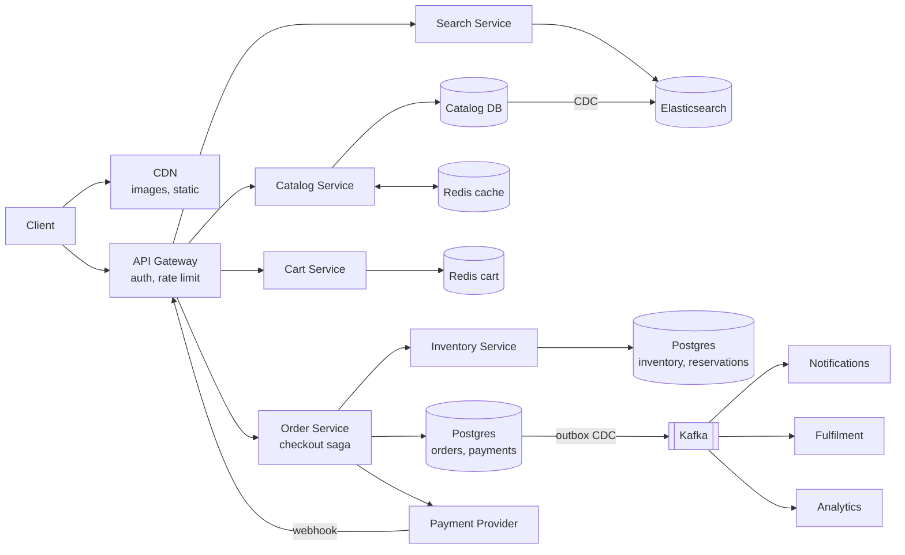

# E-Commerce Platform like Amazon (HLD, interview version)

**Core idea:** browsing is huge and read-heavy, so serve it from cache, CDN and search with eventual consistency. Checkout is small but must be correct: **never oversell stock and never charge twice**. Spend most of the interview on checkout.

**Terms:** **SKU** = one sellable variant (e.g. "iPhone 16, 128 GB, black"). **Reservation** = stock held for an order for a few minutes while the user pays. **PSP** = payment service provider (Stripe, Razorpay).

## 1. Requirements
**Functional**
- Search and browse products, view a product page
- Add to cart, checkout, pay
- Order history and status (placed, shipped, delivered, cancelled)
- (Good to have) Flash sales

**Out of scope:** seller onboarding, recommendations, reviews, delivery logistics.

**Non-functional**
- Browse/search p99 < 200 ms, 99.99% available
- Checkout: strong consistency for stock and payment; no overselling, no double charge
- Handles 10x traffic spikes (sales)

## 2. Estimates
- 50M DAU x 20 page views = 1B views/day = about **12K reads/sec**, peak (sale) about **60K/sec**
- 5M orders/day = about **60 orders/sec**, peak about 600/sec. Read:write about 200:1
- Catalog: 100M products x 5 KB = **500 GB** (images in S3 + CDN)
- Orders: 5M x 2 KB x 365 x 5 years = about **18 TB**, so shard orders

## 3. Entities and API
**Entities:** User, Product, SKU, Inventory, Cart, Order, OrderItem, Reservation, Payment.

- `GET /v1/search?q=&category=&cursor=` returns product cards (cursor pagination)
- `GET /v1/products/{productId}` returns details, SKUs, price, "in stock" flag
- `PUT /v1/cart/items` body `{skuId, qty}` (qty 0 removes). `GET /v1/cart`
- `POST /v1/checkout` header `Idempotency-Key`, body `{addressId, paymentMethodId}`
  returns `201 {orderId, status: PENDING_PAYMENT, amount, paymentClientSecret}`, or `409 {outOfStock: [skuId]}`
- `POST /v1/webhooks/payments` (from PSP, signature verified): payment succeeded / failed
- `GET /v1/orders/{orderId}`, `GET /v1/orders?cursor=`

Auth: JWT at the gateway. Rate limit per user and IP, stricter on checkout.

## 4. Flows
**Browse / search (read path)**
1. Product images and static pages come from the CDN.
2. Search goes to Elasticsearch. Product page reads Redis, then the catalog DB on a miss.
3. "In stock" on the page comes from a cache and may be slightly stale. The real check happens at checkout.

**Checkout (write path)**
1. `POST /checkout`. Order service reads the cart and current prices (never trusts client prices).
2. **Reserve stock** for each SKU: Inventory service does the conditional update and inserts a reservation (expires in 10 min) in one transaction (see Deep Dives). If any SKU fails, release the others and return `409`.
3. Create the order (`PENDING_PAYMENT`) with a price snapshot in `order_items`.
4. Create a payment intent with the PSP using `order_id` as the idempotency key. Return `clientSecret`; the client pays with the PSP directly.
5. PSP webhook "succeeded": mark payment and order `PAID`, convert reservations to sold, clear cart, publish `OrderPlaced` (outbox).
6. Webhook "failed" or reservation expired: mark order `CANCELLED`, release stock.

## 5. Data Model
| Data | Store | Why |
|---|---|---|
| Catalog (products, SKUs, attributes) | **DynamoDB / MongoDB** | Read-heavy, flexible attributes per category |
| Inventory, reservations | **Postgres**, sharded by `sku_id` | Atomic conditional updates |
| Orders, order items, payments | **Postgres**, sharded by `user_id` | Transactions; "my orders" stays on one shard |
| Cart | **Redis** (backed by DynamoDB) | Fast, per-user key |
| Search | **Elasticsearch**, fed from catalog via CDC | Full-text, filters, facets |
| Images | **S3 + CDN** | Static |

- `inventory (sku_id PK, available, reserved)`
- `reservations (reservation_id PK, order_id, sku_id, qty, status ACTIVE | SOLD | RELEASED, expires_at)`, index `(status, expires_at)` for the expiry job
- `orders (order_id PK, user_id, status, total, address, created_at)`, index `(user_id, created_at DESC)`
- `order_items (order_id, sku_id, qty, unit_price)`: price at the time of purchase
- `payments (payment_id PK, order_id UNIQUE, psp_ref, amount, status)`: `UNIQUE` blocks a second payment per order
- Order IDs: Snowflake (sortable, no coordination)

## 6. Deep Dives
### Inventory: no overselling (the key question)
- Reserve with one atomic conditional update, no read-then-write:
  `UPDATE inventory SET available = available - :q, reserved = reserved + :q WHERE sku_id = :s AND available >= :q`
  0 rows updated = out of stock.
- Reserve **at checkout, not at add-to-cart**, otherwise carts lock stock for days.
- On payment success: `reserved -= q` (sold). On failure or expiry: `available += q, reserved -= q`.
- An expiry job scans `reservations WHERE status = ACTIVE AND expires_at < now()` and releases them.
- Why not pessimistic locks (`SELECT ... FOR UPDATE`): holds row locks across slow calls and kills throughput on popular SKUs.

### Checkout as a saga
- Steps: reserve stock, create order, take payment, confirm. Each has a compensation: release stock, cancel order, refund.
- **Orchestrated** by the Order service (one place holds the state machine: `PENDING_PAYMENT -> PAID -> SHIPPED -> DELIVERED`, or `CANCELLED`).
- **Outbox:** order status change and its event are written in the same transaction; CDC publishes to Kafka, so DB and events never disagree.
- Why not 2PC across inventory, orders and the PSP: the PSP does not support it, and it blocks on failures.

### Payments: no double charge
- Client retries `POST /checkout` with the same `Idempotency-Key`, so it gets the same order back.
- PSP call uses `order_id` as its idempotency key, so a retried call does not charge again.
- Webhooks arrive at least once and out of order: dedupe by PSP event ID, and only move the order state forward.
- Webhook lost: a reconciliation job asks the PSP for the status of orders stuck in `PENDING_PAYMENT`.
- Payment succeeded after the reservation expired: re-reserve if stock exists, else auto-refund.

### Flash sale (hot SKU)
- 1M users, 1,000 units: a single DB row becomes the bottleneck.
- Gate in Redis: stock counter decremented atomically (Lua script); only winners proceed to the DB reservation.
- Put a virtual queue / waiting room in front, and rate limit per user. Serve the sale page fully from CDN.

### Cache and search
- Product pages: Redis cache-aside, TTL minutes, invalidated on price change. Images and static content on CDN.
- Search index updated via CDC from the catalog; a few seconds stale is fine.
- Price shown may be cached; checkout always reads the current price.

## 7. Async, Failures, Trade-offs
- **Kafka events** (`OrderPlaced`, `OrderCancelled`, `PaymentFailed`) feed notifications (email/SMS), fulfilment, analytics. Consumers are idempotent (dedupe by event ID), DLQ for failures.
- **Failures:** PSP down means checkout fails fast with a circuit breaker while browsing stays up. Order DB shard down affects only those users. Retries use backoff with jitter.
- **Metrics:** checkout success rate, payment failure rate, oversell count (should be 0), reservation expiry rate, search p99.
- **Trade-offs:** reserve at checkout vs at cart (fewer locked items vs "item gone at checkout"); document DB for catalog vs SQL (flexible attributes vs joins); eventual stock on product page vs strong at checkout.
- **10x bottleneck:** hot SKU rows during sales (Redis gate, split stock into N sub-counters) and search cluster size.

## Diagram

