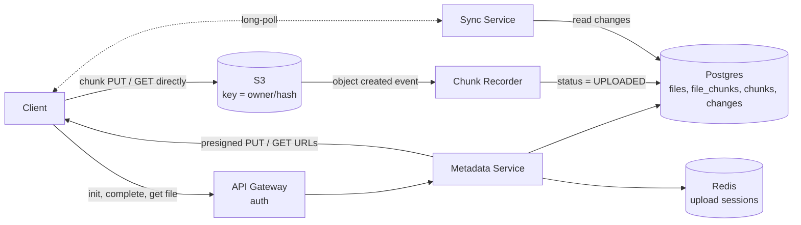

# File Storage like Dropbox / Google Drive (HLD, interview version)

**Core idea:** file bytes never pass through our servers. The client splits a file into chunks, sends their hashes, and gets **presigned S3 URLs** to upload/download chunks directly. Our servers only store metadata.

**Terms:** **Chunk** = 4 MB piece of a file, named by its SHA-256 hash. **Presigned URL** = short-lived S3 link that allows one PUT or GET on one object without AWS credentials.

## 1. Requirements
**Functional**
- Upload and download files (up to 50 GB)
- Sync changes across a user's devices
- (Good to have) Share a file with another user

**Non-functional**
- Durable: a completed upload is never lost
- Large uploads are resumable and only changed chunks are re-sent
- Sync: a change shows on other devices in a few seconds
- Strong consistency for metadata, eventual for everything else

## 2. Estimates
- 100M DAU x 2 uploads/day = 200M/day = about **2.3K uploads/sec**
- 200M x 500 KB average = **100 TB/day** of new data, so file bytes must go straight to S3, not through app servers
- Metadata is small (about 500 B per file), so a sharded SQL DB handles it

## 3. API
- `POST /v1/uploads/init` body `{name, parentId, size, chunkHashes[], baseRev?, uploadId?}`
  returns `{uploadId, missingChunks: [{hash, presignedPutUrl}]}`. URLs only for hashes not yet uploaded. Pass the same `uploadId` to resume.
- `POST /v1/uploads/{uploadId}/complete`
  returns `200 {fileId, rev}`, or `409 {latestRev}` if the file changed since `baseRev`.
- `GET /v1/files/{fileId}?rev=`
  returns `{name, size, rev, chunks: [{hash, presignedGetUrl}]}` in order.
- `GET /v1/changes?cursor=` returns file changes since the cursor and a new cursor (used with long-poll for sync).

## 4. Flows
**Upload**
1. Client splits the file into 4 MB chunks and computes SHA-256 of each.
2. `init` with the full ordered hash list. Server looks up each hash in `chunks` and returns presigned PUT URLs only for hashes with no `UPLOADED` row (dedup). S3 key = `{owner_id}/{hash}`.
3. Client PUTs those chunks **directly to S3** in parallel, retrying each one on its own.
4. S3 sends an "object created" event per chunk. A **Chunk Recorder** worker inserts `chunks (owner_id, hash, UPLOADED, ref_count = 0)`.
5. `complete`. Server confirms every hash is `UPLOADED`, then in **one transaction**: checks `baseRev`, writes `file_chunks` rows for the new rev, increments `ref_count` of each hash, bumps `files.latest_rev`, appends a `changes` row. Only now is the file visible.

**Download**
1. `GET /files/{id}`. Server checks access, reads `file_chunks` for that rev ordered by `idx`, returns presigned GET URLs (expire in minutes).
2. Client downloads chunks from S3 (or a CDN) in parallel, checks each SHA-256, joins them.

**Sync on another device**
1. Device holds a long-poll request. When a new `changes` row appears for this user, the server answers "changed".
2. Device calls `GET /changes?cursor=`, loads the new chunk list of each changed file, compares it with its local list, and downloads only the missing chunks.

## 5. Data Model
| Data | Store |
|---|---|
| Files, chunk lists, chunk catalog, change log | **Postgres / MySQL**, sharded by `owner_id` |
| Chunk bytes | **S3**, key `{owner_id}/{hash}` |
| Upload sessions (`uploadId` -> target file, hash list, `baseRev`) | **Redis** (24 h TTL) |

| Table | One row per | Answers |
|---|---|---|
| `files (file_id PK, owner_id, parent_id, name, latest_rev, size, updated_at)` | file | Name, folder, latest version |
| `file_chunks (file_id, rev, idx, chunk_hash)` PK `(file_id, rev, idx)` | position in a file version | Which chunks, in what order, make up this version. No bytes, only hashes |
| `chunks (owner_id, chunk_hash, size, status, ref_count)` PK `(owner_id, chunk_hash)` | unique chunk stored in S3 | Is this chunk already uploaded? How many versions use it? |
| `changes (owner_id, seq, file_id, rev, op)` PK `(owner_id, seq)` | change event | What changed since the device's cursor (last `seq` seen) |

**Example:** `report.pdf` (file 501) rev 1 = `[a1, b2, c3]`. Edit the middle, rev 2 = `[a1, x9, c3]`.
- `file_chunks` has 6 rows (3 per rev). Hashes repeat across versions.
- `chunks` has 4 rows: `a1` (ref 2), `b2` (ref 1), `c3` (ref 2), `x9` (ref 1). S3 holds 4 objects.
- The edit uploaded only `x9`. Rev 1 still restores because its rows still point to `b2`.

## 6. Deep Dives
### Chunking, edits and dedup
- **Finding changed chunks:** the client re-chunks and re-hashes the whole file and sends the full new list. Unchanged chunks keep the same hash, so they already exist; only new hashes get URLs. The server never computes a diff.
- **Parallel:** many chunks upload at once, so big files are faster.
- **Dedup:** same content = same hash = stored once. Scoped per user (`owner_id` in the key), because global dedup leaks "this file already exists somewhere".
- **Limitation:** with fixed 4 MB chunks, inserting bytes near the start shifts every later chunk and changes all their hashes. Fix: content-defined chunking (rolling hash picks boundaries, like rsync), so only 1-2 chunks change.

### Presigned URLs, resume and the complete step
- Each URL is for one key, one method, and expires in about 15 minutes.
- Require the SHA-256 in the PUT (`x-amz-checksum-sha256`), so S3 rejects bytes that do not match the hash.
- **Resume:** 10 URLs, 8 succeed, 2 fail or expire. The 8 are already `UPLOADED` (from S3 events), so calling `init` again returns only 2 fresh URLs. An expired URL loses nothing: S3 checks expiry only when the PUT starts.
- The server does not trust the client's "I uploaded these"; it decides from `chunks` and re-checks at `complete`.
- `complete` is required because S3 alone has chunks but no file. A half-finished upload is never visible.
- **Cleanup:** chunks uploaded but never completed, or whose versions were deleted, have `ref_count = 0`. A job deletes them from S3 and `chunks` after a few days.

### Conflicts
- `complete` does `UPDATE files SET latest_rev = latest_rev + 1 WHERE file_id = ? AND latest_rev = :baseRev`. If 0 rows change, return `409`.
- On `409` the client keeps both: saves its version as "file (conflicted copy)". No edit is lost.
- `init` and `complete` take an `Idempotency-Key`, so retries do not create duplicate versions.

## 7. Would Also Add (one line each if asked)
Sharing and ACL checks, CDN for popular files, Kafka events for thumbnails/search, rate limiting at the gateway, multi-region S3 replication, monitoring of upload success rate and sync latency.

## Diagram

