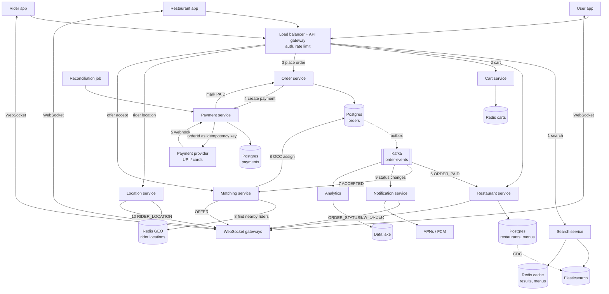

# Food Delivery System (HLD, interview version)

**Core idea:** users search restaurants near them (Elasticsearch with a location filter), build a cart, and place an order. Payment goes through an external provider, and the provider's webhook confirms it. The order then moves through Kafka: the restaurant accepts and cooks, and the Matching service finds a nearby rider from live locations (Redis GEO) and assigns the order with an optimistic lock. Users, restaurants and riders get live status over WebSocket, plus push notifications when the app is in the background.

**Terms:**

- **Webhook:** a server-to-server HTTP callback, here the payment provider calling us.
- **WebSocket:** a long-lived connection used to push live updates to the apps.
- **OCC:** optimistic concurrency control. An update succeeds only if the row's version hasn't changed since it was read.
- **GEO index:** answers "who is within X km of this point."

## 1. Requirements

**Functional**

- Users, riders and restaurant admins sign up and log in
- Users search restaurants and dishes near them, by name or category
- Users add items and quantities to a cart (one restaurant per cart)
- Users pay online (UPI / PhonePe, cards) or choose cash on delivery (COD)
- Users track their order live and see order history
- Restaurant admins: set the store online or offline, add, edit or remove items, mark items unavailable, accept or reject orders, mark orders ready for pickup
- Riders: go online or offline, receive order offers, accept or reject them, send their location, mark orders picked up and delivered

**Out of scope:** grouped deliveries, support, wallet and gift cards, surge pricing, incognito mode, promotions, ratings and reviews.

**Non-functional**

- GET API p99 < 500 ms
- No duplicate orders from the same cart, and payments are idempotent per order
- **CP** for payments and order state. **AP** for search, menus, location and ETA, where a few seconds of staleness is fine.
- 99.99% availability, horizontally scalable, multi-region
- Rider location shows up for the user within about 5 s

## 2. Estimates (assumptions)

- 50M registered users, 10M DAU, 200K restaurants
- 2M orders/day, about **25 orders/sec** on average. Lunch and dinner peaks run about 10x, so about **250 orders/sec**.
- About 10 searches and menu views per order, so 20M/day and about **2.5K reads/sec at peak**. This is read-heavy, so cache it.
- 300K riders online at peak, each sending a location every 5 s, gives about **60K writes/sec**. This is the biggest write load, which is why location lives in Redis GEO and not in the main DB.
- Live connections (riders, restaurants, users tracking an order) peak around 1M. At 50K per gateway that's about 20 WebSocket gateways.
- An order record is about 2 KB, so 4 GB/day, about 1.5 TB/year. Payment records are kept as long as Finance/Legal require. Order details stay in the main DB for about a year, then move to cheaper archive storage.
- **Takeaway:** order volume is small. The hard parts are search reads, location writes, and getting payment and rider assignment right.

## 3. API

**Auth**

- `POST /v1/signup` body `{role: USER | RIDER | RESTAURANT_ADMIN, ...}`
- `POST /v1/login` returns a JWT, with the role inside the token

**User**

- `GET /v1/search?q=&category=&lat=&lng=&cursor=` returns open restaurants that deliver to this location
- `GET /v1/restaurants/{id}` returns details and menu
- `PUT /v1/cart` body `{restaurantId, items: [{itemId, qty}]}` returns `cartVersion`
- `POST /v1/orders` body `{cartId, cartVersion, addressId, paymentMethod}` returns `{orderId, paymentRedirectUrl}`
- `GET /v1/orders/{id}` returns status, rider location and ETA
- `GET /v1/orders?cursor=` returns order history (userId comes from the token)

**Restaurant admin**

- `PATCH /v1/restaurants/{id}/status` body `{online}`
- `POST /v1/restaurants/{id}/items`, `PATCH /v1/restaurants/{id}/items/{itemId}`, `DELETE /v1/restaurants/{id}/items/{itemId}`
- `PATCH /v1/orders/{id}` body `{action: ACCEPT | REJECT | READY, prepMinutes}`

**Rider**

- `PATCH /v1/riders/{id}/status` body `{online}`
- `POST /v1/riders/{id}/location` body `{lat, lng, ts}` every 5 s (can also go over the WebSocket)
- `POST /v1/offers/{offerId}/accept` body `{version}`, and `POST /v1/offers/{offerId}/reject`
- `PATCH /v1/orders/{id}` body `{action: PICKED_UP | DELIVERED}`

**Inbound webhook (from the payment provider)**

- `POST /v1/payments/webhook` body `{providerRef, orderId, status}`. Verify the provider's signature before trusting it.

**Real-time pushes over WebSocket (server to apps)**

- To restaurant: `NEW_ORDER {orderId, items}`
- To rider: `OFFER {offerId, orderId, pickup, drop, expiresIn}`
- To user: `ORDER_STATUS {orderId, status, eta}` and `RIDER_LOCATION {lat, lng}`
- If the app is in the background, send a push notification instead (APNs / FCM)

## 4. Flows

**Restaurant goes live**

1. Admin logs in and calls `PATCH /status {online: true}`. The Restaurant service updates its DB.
2. CDC (change data capture) carries the change to Elasticsearch (`is_open = true`), so the restaurant now appears in search.

**Place an order (happy path)**

1. User searches. The Search service queries Elasticsearch, filtered by distance and `is_open`. Popular queries are cached.
2. User opens a restaurant (menu served from cache) and builds a cart in the Cart service (Redis).
3. `POST /orders`: the Order service re-checks prices and availability, then creates the order as `PAYMENT_PENDING`. A unique key on `(cartId, cartVersion)` means a double tap or retry returns the same order.
4. The Payment service creates the payment with the provider, using `orderId` as the idempotency key, and redirects the user to pay.
5. The provider calls our webhook. We verify the signature, mark the payment `SUCCESS` and the order `PAID` (with an outbox row in the same transaction), return 200, and the relay publishes `ORDER_PAID` to Kafka. Duplicate webhooks are ignored because the payment is already `SUCCESS`.
    - **COD:** skip steps 4-5. The order goes straight to `CONFIRMED`.
6. The Restaurant service consumes `ORDER_PAID` and pushes `NEW_ORDER` to the restaurant app through the WebSocket gateway.
7. Restaurant accepts and gives a prep time. An `ACCEPTED` event goes out, and the Matching service schedules dispatch so the rider arrives about when the food is ready.
8. Matching assigns a rider (see the deep dive), and a `RIDER_ASSIGNED` event goes out.
9. Restaurant marks `READY`, then the rider marks `PICKED_UP` and `DELIVERED`. Each status change goes to Kafka, and the Notification service sends it to the user over WebSocket or push.
10. During delivery, the Location service writes to Redis GEO and forwards the rider's location to the user tracking that order.
11. The Analytics consumer reads the same order events and writes them to the data lake.

**Unhappy paths**

- **Payment webhook never arrives:** a reconciliation job checks with the provider for any order stuck in `PAYMENT_PENDING` for more than 10 minutes. If the payment succeeded, continue. If it failed or timed out, mark the order `EXPIRED`.
- **Restaurant rejects or doesn't respond within N minutes:** order becomes `REJECTED`, the Payment service issues a refund (idempotent, keyed by orderId), and the user is notified.
- **No rider accepts:** widen the search radius and retry. After X minutes, alert ops and offer the user a cancel with refund.
- **Rider cancels after accepting:** unassign (bump the version) and run matching again.
- **Item became unavailable between cart and checkout:** the check in step 3 fails and the user is asked to update the cart.

## 5. Data Model

| Data | Store | Why |
|---|---|---|
| Users, riders, restaurants, menus | **Postgres** + read replicas + Redis cache | Relational, small, read-heavy |
| Search index (restaurants, dishes, geo point, `is_open`) | **Elasticsearch** | Full-text search plus location filter; fed by CDC |
| Carts | **Redis** (TTL about 24 h) | Short-lived, edited often |
| Orders | **Postgres** (shard by `user_id` when needed) | State changes need transactions and unique constraints; ~250 writes/sec is easy for Postgres |
| Payments | **Postgres** (separate DB) | Strong consistency and an audit trail |
| Rider live locations | **Redis GEO**, sharded by city | 60K writes/sec and fast radius queries |
| Order events | **Kafka** topic `order-events`, keyed by `orderId` | Keeps one order's events in order |
| Analytics | Data lake | Reporting, ETA model training |

**Entities**

- `user (id, name, email, phone, rating)`
- `address (id, user_id, label, lat, lng, text)`
- `rider (id, name, email, phone, vehicle_no, status OFFLINE | IDLE | ON_DELIVERY, city)`
- `restaurant (id, name, address, lat, lng, phone, rating, is_open)`
- `item (id, restaurant_id, name, category, price, is_available, description)`
- `cart (id, user_id, restaurant_id, items [{item_id, qty}], version)`
- `order (id, user_id, restaurant_id, rider_id NULL, address_snapshot, items_snapshot [{item_id, name, price, qty}], total, payment_method, status, eta, version, cart_id, cart_version, created_at)` with `UNIQUE (cart_id, cart_version)`
- `payment (id, order_id UNIQUE, provider, provider_ref, amount, status INITIATED | SUCCESS | FAILED | REFUNDED, created_at)`
- `delivery_offer (id, order_id, rider_id, status, expires_at)`

The order stores a **snapshot** of item prices and the address, because menus change after the order is placed.

**Order states:** `PAYMENT_PENDING -> PAID (or CONFIRMED for COD) -> ACCEPTED -> RIDER_ASSIGNED / READY_FOR_PICKUP (either order) -> PICKED_UP -> DELIVERED`. Side exits: `CANCELLED`, `REJECTED -> REFUNDED`, `EXPIRED`.

**Indexes**

- `orders (user_id, created_at)` for order history
- `orders (restaurant_id, status)` for the restaurant's live dashboard
- `orders (status, created_at)` for the reconciliation job
- `items (restaurant_id)`

## 6. Deep Dives

### Rider matching (most likely deep dive)

1. **When:** on `ACCEPTED`, schedule dispatch for (food ready time minus rider travel time), so riders don't wait at the restaurant.
2. **Find candidates:** run a Redis GEO search within 3 km of the restaurant. Keep riders who are `IDLE` and whose last location update is under 30 s old.
3. **Rank:** travel time to the restaurant, how long the rider has been idle (fairness), acceptance rate.
4. **Offer:** send to the top rider with a 15-20 s timeout, or to the top 3 at once for speed, and create a `delivery_offer` row. Lock the rider while an offer is open (`SET rider:{id}:offer NX EX 20`), so nobody gets two offers at the same time.
5. **Accept with OCC:**
   ```sql
   UPDATE orders
   SET rider_id = :rider, status = 'RIDER_ASSIGNED', version = version + 1
   WHERE id = :order AND rider_id IS NULL AND version = :v;
   ```
   1 row updated means this rider won. 0 rows means someone else already took it, so tell the rider "order taken." Set the rider to `ON_DELIVERY` in the same step.
6. **Timeout or reject:** offer to the next candidate. If the list runs out, widen to 5 km and retry. After N minutes, escalate.

### Location and live tracking

- The rider app sends its location every 5 s. The Location service writes it to Redis GEO (keyed per city) along with a last-seen timestamp. Individual updates are not written to the main DB. A sample goes to Kafka and on to the data lake for ETA modelling.
- For an active order, the Location service looks up which gateway the user is connected to and pushes the rider's position there. A few seconds of delay is fine.
- Riders with no update for 30 s or more are excluded from matching.

### Payments and no double orders

- **Two separate keys:**
    - `UNIQUE (cart_id, cart_version)` on orders, so a double tap returns the same order.
    - `orderId` as the idempotency key sent to the provider, so retries never charge twice.
- **Webhook:** verify the signature, update with `WHERE status = 'INITIATED'` so duplicates do nothing, return 200 quickly, then emit the event.
- **Outbox pattern:** write the order status and an outbox row in one transaction, and a relay publishes the outbox rows to Kafka. This avoids "DB updated but event lost."
- **Safety nets:** the reconciliation job, plus a daily settlement check against the provider's report.
- **CP:** if the payment can't be confirmed, show "payment pending." Never mark an order paid without confirmation.

### Search

- Elasticsearch documents hold the restaurant, its dishes and categories, `geo_point`, `is_open`, rating and delivery radius.
- **Query:** text or category, plus a `geo_distance` filter and `is_open = true`. Sort by relevance, distance or rating.
- **Freshness:** restaurant DB → CDC (e.g. Debezium) → Kafka → indexer → Elasticsearch. A few seconds of lag is fine, but `is_open` is re-checked when the order is placed.
- **Caching:** popular results cached in Redis by (geohash cell, query) with a 30-60 s TTL. Menus cached by `restaurant_id` and cleared when the menu is edited.

### ETA

- **First estimate:** prep time (the restaurant's estimate or its historical average) + rider travel to the restaurant + travel to the customer (maps routing API or a distance-based estimate).
- Re-estimate as the rider moves. Later, train a model on historical data from the data lake.

## 7. Reliability, Ops, Trade-offs

- **Rate limiting** at the gateway per userId (token bucket), with tighter limits on login and order creation.
- **Kafka consumers are idempotent:** dedupe by eventId or (orderId, status). Failed messages go to a DLQ with alerts, especially for the restaurant and matching consumers.
- **Multi-region:**
    - stateless services run in every region
    - Postgres has a primary with replicas and failover
    - Redis GEO is per city, so it's regional by nature
    - Elasticsearch runs with replicas
- **Deploys:** canary for services that touch orders or payments (a small % of traffic first, watching error rate and payment success). Blue-green is fine for the rest. Drain WebSocket gateways slowly to avoid a reconnect storm.
- **Metrics:**
    - p95 / p99 latency for search and order APIs
    - payment success rate and webhook lag
    - orders stuck in each state
    - time to assign a rider and offer acceptance rate
    - Kafka consumer lag and DLQ size
    - cache hit rate
- **Trade-offs:**
    - **Postgres vs NoSQL for orders:** transactions and constraints vs easier horizontal scaling. Volume is low, so Postgres.
    - **Offer to one rider vs several:** fair with no conflicts vs faster assignment (OCC resolves the conflicts).
    - **Push rider location vs user polling:** smooth tracking vs simpler.
    - **Kafka events (choreography) vs a workflow engine like Temporal (orchestration):** loose coupling vs one place to see the order lifecycle and handle timeouts.
- **At 10x:**
    - location writes: shard Redis by city
    - search traffic: more Elasticsearch replicas and caching
    - connections: more WebSocket gateways
    - dinner-peak bursts: autoscaling, with Kafka absorbing spikes

## Interview time plan (45 min)

| Phase | Time |
|---|---|
| Requirements + out of scope | 4-5 min |
| Estimates (call out the 60K/sec location writes) | 3 min |
| API (key endpoints only) | 4 min |
| Diagram + order flow | 10-12 min |
| Data model + order states | 5 min |
| Deep dives: rider matching + payments | 10-12 min |
| Failures, trade-offs, 10x | 3 min |

## What changed from the original notes

- "Webhook" now means only the payment provider's callback. Live updates to the apps go over WebSocket or push notifications.
- "CA for payments" became "CP for payments and order state."
- Estimates now have numbers, and location writes are named as the heaviest load.
- Notifications read directly from Kafka, not after the data lake.
- Added unhappy paths: missing webhook, restaurant rejection with refund, no rider, rider cancel.
- Expanded the order states, with price and address snapshots on the order.
- "No double orders" is enforced with `UNIQUE (cart_id, cart_version)`.
- Orders moved from NoSQL to Postgres, with the reasoning.
- Rider matching expanded from the OCC note into the full trigger, find, rank, offer, accept and retry flow.
- Search now explains how data reaches Elasticsearch (CDC) and adds the location and open-now filters.
- Added ETA, the outbox pattern, and a deploy answer (canary for orders and payments).

## Diagram


