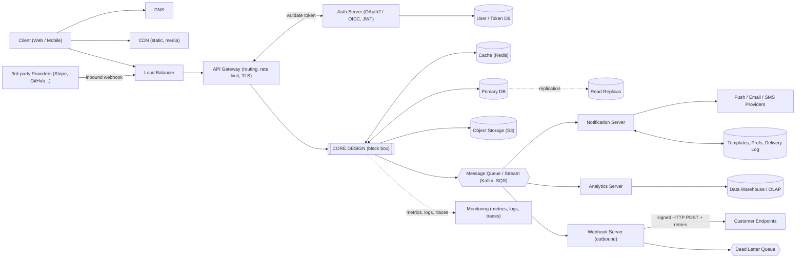

**Time split (45-60 min):** Requirements 5 | Estimates 3 | Entities + API 5 | Architecture 10 | Deep dives 15-20 | Wrap-up 5

## 1. Requirements and Scope
- Ask clarifying questions first (users, platforms, regions, scale).
- **Functional requirements:** the 3-5 core features. List what is explicitly **out of scope**.
- **Non-functional requirements:**
  - Latency (e.g. p99 read < 200 ms, write < 500 ms)
  - Availability (e.g. 99.9% / 99.99%)
  - Consistency (strong vs eventual, and where)
  - Durability, scalability, security, cost

## 2. Back-of-Envelope Estimates 
- Total users, DAU, read:write ratio
- Reads and writes per DAU per day
- QPS = daily requests / 86,400. Peak QPS = 2-3x average
- Storage per record x records per day x 365 x 5 years
- Bandwidth = QPS x payload size
- Cache size (e.g. cache hot 20% of daily reads)
- Rough cost (storage, cache vs DB)

## 3. Core Entities and API Design
- **Core entities** first (User, Order, Post...) and their relationships
- Endpoints, request/response shape, status codes
- Pagination (cursor over offset), idempotency keys for writes
- Protocol choice: REST vs gRPC vs WebSocket/SSE, and why
- **AuthN/AuthZ:** OAuth2/OIDC, JWT (stateless) vs session (revocable), token refresh, RBAC/ABAC
- **Rate limiting:** token bucket, sliding window; per user / IP / API key; where it lives (gateway vs service)

## 4. High-Level Architecture
Components to consider (include only what the problem needs):
- Client, DNS, CDN
- Load balancer, API gateway (auth, rate limit, routing)
- Application services (stateless, horizontally scalable)
- Cache, primary DB, read replicas
- Message queue / stream (Kafka, SQS)
- Object storage (S3) for blobs
- Search service (Elasticsearch) if needed
- Async workers, notification service, analytics service
- **Mermaid diagram goes here**

Also write 1 numbered **data flow** for the write path and 1 for the read path.

## 5. Data Model, DB Choice, Indexes
- **DB choice by access pattern:** read/write ratio, relations, scale, query shape.
  - SQL: relations, transactions, strong consistency
  - Key-value / wide-column (DynamoDB, Cassandra): huge scale, simple access by key
  - Document (MongoDB): flexible schema
  - Graph: relationship traversal
  - Time-series / OLAP: metrics, analytics
- **Schema:** tables, columns, types, PK, FK
- **Indexes:** each index with the query it serves (and write cost)
- **ACID:** which operations need transactions; where you relax it and why
- **ID generation:** auto-increment vs UUIDv7 vs Snowflake (sortable, no coordination)
- **Data lifecycle:** retention, archival to cold storage, soft vs hard delete, PII / GDPR deletion

## 6. Deep Dives
### Cache
- Where: client, CDN, app (local), distributed (Redis)
- Read patterns: cache-aside, read-through
- Write patterns: write-through, write-back, write-around
- Eviction (LRU/LFU), TTL, invalidation
- Problems: stampede, penetration, hot keys
### Scalability
- Sharding / partition key choice, consistent hashing
- Hot partitions, read replicas, replication lag
- Backpressure and load shedding under overload
### Consistency and CAP
- Where you choose strong vs eventual, and why
- Read-your-writes, PACELC (latency vs consistency when no partition)
### Concurrency
- Race conditions (double booking, double spend, counters)
- Optimistic vs pessimistic locking, distributed locks, idempotency
### Distributed Transactions
- Saga (choreography vs orchestration) with compensating actions
- Transactional outbox + CDC (Debezium) to avoid dual writes to DB and queue
- Why 2PC is usually avoided (blocking, coordinator failure)
### Real-time (if needed)
- WebSocket/SSE connection servers, connection registry, fan-out on write vs read, presence

## 7. Async Flows
- Queues/streams: at-least-once vs exactly-once, ordering, retries, DLQ
- **Notification service:** channels (push, email, SMS), templates, retries, user preferences, dedupe
- **Analytics service:** event ingestion, stream processing, data warehouse, dashboards
- **Webhooks:**
  - Inbound (from Stripe etc.): verify signature, dedupe by event ID, ack fast (2xx) then process async
  - Outbound (to customers): HMAC-signed payload, retries with backoff, DLQ, per-endpoint health / auto-disable, replay API

## 8. Failure Handling and Monitoring
- **Error handling:** timeouts, retries with exponential backoff + jitter, circuit breakers, idempotent retries, graceful degradation
- **Fault tolerance:** replication, failover, multi-AZ / multi-region, no single point of failure
- **Multi-region:** active-active vs active-passive, conflict resolution, RPO / RTO targets, backups + restore drills
- **Monitoring:** metrics (QPS, latency p50/p95/p99, error rate, saturation), logs, traces, alerts, dashboards, SLOs
- **Security:** encryption in transit and at rest, abuse protection, secrets management, audit logs, least privilege

## 9. Operations
- Deployment: canary, blue/green, feature flags
- Data migration and schema changes
- Cost trade-offs (storage tiering, cache vs DB)

## 10. Trade-offs and Future Work
- For each major choice: what you picked, what you rejected, why
- Bottlenecks: what breaks first at 10x scale
- Future improvements

---

## Per-Design Checklist
- [ ] Clarified scope
- [ ] FRs and NFRs stated with numbers
- [ ] Estimates done (QPS, peak, storage, bandwidth)
- [ ] Core entities listed
- [ ] API defined (auth + rate limiting)
- [ ] Diagram drawn
- [ ] Write and read flow traced
- [ ] DB choice justified by access pattern
- [ ] Schema and indexes tied to queries
- [ ] Cache strategy defined
- [ ] Consistency and concurrency addressed
- [ ] Cross-service transactions handled (saga / outbox)
- [ ] Async, notifications, analytics, webhooks (if relevant)
- [ ] Failures, multi-region and monitoring covered
- [ ] Trade-offs and 10x bottleneck named

---

## Common Building Blocks (Core Design = Black Box)
Reusable shell for any design. Replace `CORE DESIGN` with the problem-specific services.

