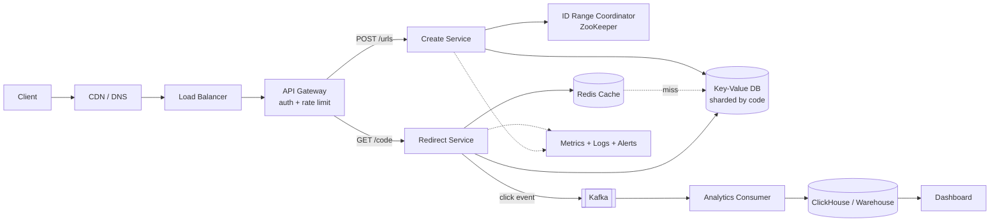
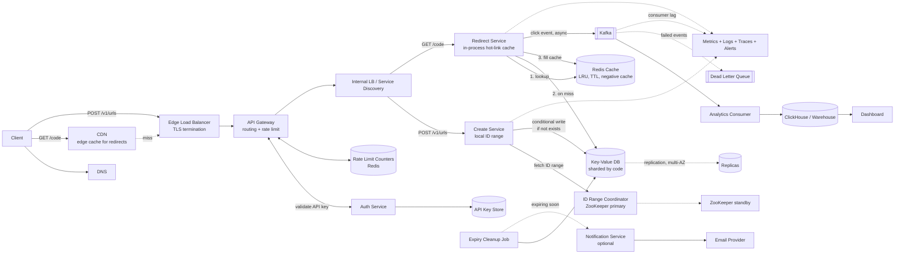

# URL Shortener (HLD)

## 1. Requirements and Scope
**Functional**
- Create a short URL from a long URL (optional custom alias, optional expiry)
- Redirect a short URL to the long URL
- (Optional) Basic click analytics

**Out of scope:** user accounts UI, link editing, spam/malware scanning.

**Non-functional**
- Redirect latency: p99 < 100 ms
- Availability: 99.99% for redirects (reads matter more than creates)
- Short codes must be unique and hard to guess
- Eventual consistency is acceptable for analytics; creates must be strongly consistent (no duplicate codes)
- Read-heavy: about 100:1 read:write

## 2. Estimates
- New URLs: 100M per month, about 40 writes/sec
- Reads: 100:1, so about 4,000 reads/sec. Peak (3x): about 12,000 reads/sec
- Total over 5 years: 100M x 12 x 5 = 6B URLs
- Record size: about 500 bytes. Storage: 6B x 500 B = 3 TB
- Short code length: base62 with 7 chars gives 62^7 = 3.5 trillion codes, which is enough
- Cache: 20% of daily reads. About 350M reads/day x 20% x 500 B = about 35 GB, so it fits in one Redis cluster

## 3. API
- `POST /v1/urls` with body `{longUrl, customAlias?, expiresAt?}`, returns `201 {shortUrl}`. Takes an `Idempotency-Key` header.
- `GET /{code}` returns `302` with a `Location` header. `404` if not found, `410` if expired.
- Use **302**, not 301, if you want click analytics (301 is cached by browsers, so clicks are not counted).
- Auth with an API key on `POST`. Rate-limit per user/IP.

## 4. Architecture
See the diagram at the end.

**Write flow**
1. Client calls `POST /v1/urls`. The API gateway authenticates and rate-limits.
2. The Create service gets a unique ID from the ID generator.
3. It encodes the ID to base62 to get the code.
4. It writes `(code, longUrl, ...)` to the DB.
5. It returns the short URL.

**Read flow**
1. Client calls `GET /{code}`.
2. The Redirect service checks Redis.
3. On a miss, it reads the DB and fills the cache.
4. It returns `302`.
5. It publishes a click event to Kafka (async, not on the hot path).

## 5. Code Generation (the key design choice)
| Option | Pros | Cons |
|---|---|---|
| Hash (MD5/SHA) + first 7 chars | Simple | Collisions, needs a retry check |
| Random 7 chars | Hard to guess | Collisions, needs a retry check |
| **Counter/ID generator + base62 (chosen)** | No collisions, simple | Sequential IDs are guessable |

- **Chosen:** Each app server takes a **range of IDs** (e.g. 1M at a time) from a coordinator (ZooKeeper or a DB sequence). It then hands out IDs locally with no per-request network call.
- To stop guessing, shuffle the bits of the ID or XOR it with a secret before encoding.
- Custom alias: insert with a unique constraint. On conflict, return `409`.

## 6. Data Model, DB Choice, Indexes
**DB choice:** a key-value store (DynamoDB or Cassandra).
- Access is almost always by `code`, there are no joins, and the data is large (3 TB) and simple.
- It scales horizontally and gives high availability.
- A SQL DB (Postgres) with sharding also works at this scale. Say so as the alternative.

**Table `urls`**
| Column | Type | Notes |
|---|---|---|
| code | string | **PK / partition key** |
| long_url | string | |
| user_id | string | optional |
| created_at | timestamp | |
| expires_at | timestamp | optional, can be used as TTL |

**Indexes**
- Primary key on `code` serves the redirect lookup.
- Secondary index on `(user_id, created_at)` serves "list my URLs". Add only if that feature is needed.
- To avoid duplicate long URLs per user, use a secondary index on `hash(long_url)`. This is optional.

**ACID:** The insert is a single-row write, so atomicity and uniqueness are enough. No multi-row transactions are needed. Use a conditional write (`if not exists`) for aliases.

## 7. Deep Dives
**Cache (Redis)**
- Read: cache-aside. Write: write-around (don't cache on create, cache on first read).
- Eviction: LRU. TTL: 24 h, and never longer than `expires_at`.
- Hot link problem: a viral link can overload one Redis key. Mitigate with a small in-process cache on each app server.
- Negative caching: cache "not found" briefly to protect the DB from bad codes.

**Scaling**
- App servers are stateless and sit behind a load balancer.
- Shard the DB by `code` (hash). Add read replicas if the DB is SQL.
- Redirect and Create can be deployed as separate services because their loads differ.

**Expiry:** Check `expires_at` on read. A background job (or DB TTL) cleans up old rows.

## 8. Analytics and Notifications
- **Analytics:** The redirect service publishes `{code, timestamp, ip, userAgent, referrer}` to Kafka. A consumer aggregates the events into a store (ClickHouse or a data warehouse) for dashboards. If this path fails, the redirect still works.
- **Notifications:** Not needed. Optionally email the user when a link is about to expire.

## 9. Failures and Monitoring
- **Cache down:** fall back to the DB. Keep rate limits on to protect it.
- **DB node down:** replication plus automatic failover. Multi-AZ.
- **Kafka down:** drop or buffer the click events. Never block the redirect.
- **ID generator down:** app servers keep using their local range. Use a second coordinator node.
- **Retries:** exponential backoff with jitter. Create is safe to retry because of the idempotency key.
- **Metrics:** redirect p50/p95/p99, error rate (4xx/5xx), cache hit ratio (target above 90%), DB latency, Kafka consumer lag, ID range remaining.
- **Alerts:** p99 latency, 5xx rate, hit ratio drop.

## 10. Trade-offs and Future Work
- **302 vs 301:** 302 gives analytics but costs more traffic. 301 is cheaper but loses click counts.
- **Counter vs hash:** the counter has no collisions but needs a coordinator. Ranges remove most of that cost.
- **KV store vs SQL:** KV scales more easily. SQL is easier for ad hoc queries.
- **First bottleneck at 10x:** the cache for viral links and the write path on the ID coordinator. Fix with local caching and bigger ID ranges.
- **Future:** multi-region with a CDN for redirects, malware checks, link editing.

## Diagram

## Full Design Diagram (All Components)

