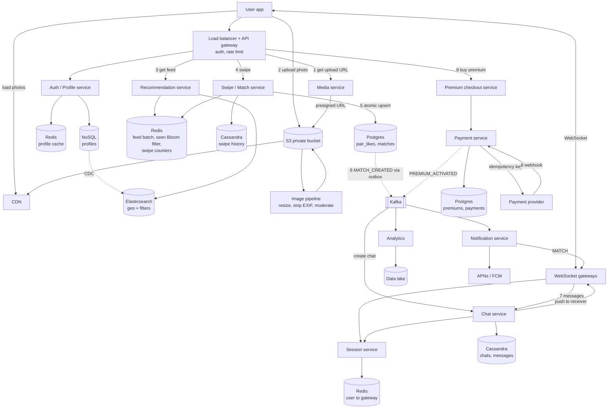

# Tinder (HLD, interview version)

**Core idea:** each user gets a precomputed batch of nearby profiles. It comes from a geo index, with already-seen people filtered out by a Bloom filter. Every swipe is saved, and a right swipe also goes to one row per pair of users that is updated atomically. Whichever right swipe arrives second sees both likes and creates the match, so a match can never be missed or created twice. A match opens a chat (WebSocket, per-chat sequence numbers). Premium is bought through a payment provider and confirmed by its webhook.

**Terms:**

- **Pair row:** one record per pair of users, keyed by `(smaller id, larger id)`, so A→B and B→A land in the same place.
- **Bloom filter:** a compact "have I seen this ID?" set. It can say "seen" for someone not actually seen (rarely), but never the other way round.
- **Webhook:** a server-to-server callback, here the payment provider calling us.
- **seq:** a per-chat increasing number that orders messages.

## 1. Requirements

**Functional**

- Users sign up, set up a profile and upload photos
- Users get a feed of nearby profiles and swipe right (like) or left (pass)
- **Match** when both users right-swipe each other, and notify both
- Matched users can chat (product choice in this design: chat requires premium; in real Tinder, chat after a match is free)
- Users buy premium (unlimited swipes, see who liked you)
- Free users get a daily swipe limit
- Users can block someone: the chat and shared photos disappear, and neither sees the other again
- Never show someone again after a left swipe, a block, or a match

**Out of scope:** chat internals beyond the basics (covered in the Chat app design), hobby and preference based filtering beyond age, gender and distance, video, boosts, ML ranking details.

**Non-functional**

- Feed read p99 < 200 ms (served from a precomputed batch); swipe write p99 < 100 ms
- No missed matches and no duplicate matches
- **CP** for payments, premium status and match creation. **AP** for the feed, profiles and location, where some staleness is fine.
- Payments: never double charge, and only one active premium per user at a time
- Photos: private storage, signed URLs, location data stripped, content moderation
- 99.99% available, multi-region

## 2. Estimates (assumptions)

- 50M registered users, **10M DAU** (20%)
- **Swipes:** about 100 per DAU per day = 1B/day, about **12K/sec on average and ~35K/sec at peak**. This is the main write load, so swipes get their own service and store.
- About 40% of swipes are right swipes, so roughly 14K/sec at peak hit the pair rows
- Feed: fetched in batches of 20, about 50M fetches/day, about 600/sec on average
- Chat: about 200M messages/day, about 2.3K/sec. At ~200 B each, that's 40 GB/day.
- Photos: 50M users × 6 photos × ~300 KB (several sizes) ≈ **100 TB** in S3, served through a CDN
- Swipe history: 1B/day × ~50 B ≈ 50 GB/day, about 18 TB/year. That's why it goes in Cassandra.
- Live connections (users with the app open): about 2M at peak. At 50K per gateway that's about 40 WebSocket gateways.

## 3. API

**Auth and profile**

- `POST /v1/signup`, `POST /v1/login` returns a JWT
- `PUT /v1/users/me` updates the profile
- `PUT /v1/users/me/location` body `{lat, lng}` (sent when the app opens)
- `POST /v1/users/me/photos/upload-url` returns a presigned S3 URL. The client uploads straight to S3, then calls `POST /v1/users/me/photos` body `{photoKey}`.

**Feed and swipes**

- `GET /v1/feed?limit=20` returns the next profiles from the user's precomputed batch
- `POST /v1/swipes` body `{targetUserId, direction: LEFT | RIGHT}` returns `{matched: true | false, matchId?}`. Returns 429 if a free user is over the daily limit.
- `GET /v1/likes` returns people who already liked you (premium only)
- `GET /v1/matches?cursor=` returns the match list

**Chat** (WebSocket frames, same as the Chat app design)

- `SEND {clientMsgId, chatId, text}` → `ACK {msgId, seq}` → `MSG` pushed to the other user → `RECEIPT {upToSeq}`
- `GET /v1/chats/{chatId}/messages?afterSeq=` for sync after reconnecting

**Premium**

- `POST /v1/premium/checkout` body `{plan}` returns a payment redirect URL. Returns 409 if a premium is already active.
- `POST /v1/payments/webhook` (from the provider, signature verified)

**Block**

- `POST /v1/blocks` body `{userId}`

**Real-time pushes (WebSocket, or push notification if the app is in the background):** `MATCH {matchId, user}`, `MSG`, `PREMIUM_ACTIVE`.

## 4. Flows

**Signup and photo upload**

1. Signup → Auth/Profile service writes the profile to the profile DB.
2. The client asks for a presigned URL and uploads the photo **directly to S3** (private bucket).
3. An S3 event triggers the image pipeline: resize, strip EXIF (removes GPS location), moderate. Approved photos are served through the CDN with signed URLs.
4. Profile changes flow through CDC into Elasticsearch, so the user starts appearing in other people's feeds.

**Get feed**

1. `GET /feed` → Recommendation service pops the next 20 IDs from the user's batch in Redis and loads those profiles (cached).
2. When fewer than 20 remain in the batch, a background job refills it (see the deep dive).

**Swipe and match (A right-swipes B)**

1. Swipe service checks the daily limit (`INCR swipes:{userId}:{date}` in Redis, compared with the plan's limit).
2. Saves the swipe to the history (Cassandra) and adds B to A's seen Bloom filter.
3. If it's a left swipe, stop here.
4. If it's a right swipe, run one atomic upsert on the pair row `(min(A,B), max(A,B))` that sets A's flag and returns both flags.
5. If only A's flag is set, return `matched: false`.
6. Later, when B right-swipes A, the same upsert returns both flags `true`. The service inserts into `matches` (unique on the pair). If the insert succeeds, it publishes `MATCH_CREATED` to Kafka through the outbox.
7. The Notification service pushes `MATCH` to both users, and the Chat service creates the chat.

**Chat** (from the Chat app design)

- The client stays connected to a WebSocket gateway, and the Session service maps each user to their gateway.
- The Chat service assigns each message a per-chat `seq`, saves it to Cassandra, acks the sender, and pushes to the receiver's gateway.
- Offline users get a push notification and sync later with `afterSeq`.
- `last_read_seq` and `last_delivered_seq` drive the receipts.

**Buy premium**

1. `POST /premium/checkout` → return 409 if a premium is already active. Otherwise create the premium as `PENDING` and the payment as `INITIATED`, using an idempotency key. Then redirect the user to the provider.
2. The provider calls the webhook. Verify the signature, then in one transaction mark the payment `PAID` and the premium `ACTIVE` with `ends_on`. Duplicate webhooks do nothing.
3. Publish `PREMIUM_ACTIVATED`: refresh the cached entitlement, and the swipe limit is lifted.
4. If the webhook never arrives, a reconciliation job checks with the provider for payments stuck in `INITIATED`.
5. An expiry job marks premiums `EXPIRED` after `ends_on`. Renewals arrive as new provider webhooks.

**Block (A blocks B)**

1. Insert into `blocks`, delete the match, and hide the chat for both users **immediately**.
2. Add B to A's seen filter and A to B's, so neither appears in the other's feed again.
3. A background job then hard-deletes the messages and shared media.

## 5. Data Model

| Data | Store | Why |
|---|---|---|
| Profiles | **NoSQL** (DynamoDB / Cassandra) + Redis cache | Simple lookups by user, read-heavy |
| Feed search (location, age, gender, last active) | **Elasticsearch**, fed by CDC | Geo distance plus filters in one query |
| Feed batch, seen Bloom filter, swipe counters | **Redis** | Fast, per user, can be rebuilt |
| Swipe history | **Cassandra**, partitioned by `swiper_id` | About 35K writes/sec; used to rebuild filters and for analytics |
| Pair likes, matches | **Postgres**, sharded by the pair key | Atomic upsert, row lock and unique constraint |
| Chats, messages | **Cassandra** | Same as the Chat app design |
| Premiums, payments | **Postgres** | Strong consistency and constraints |
| Photos | **S3** (private) + **CDN** | Large binary files |
| Events | **Kafka** | Match, premium and analytics events |

**Entities**

- `user (id, name, email, gender, birthdate, height, about, photo_keys[], location, last_active_at, created_on, updated_on)`. Preference fields like `pref_gender`, `pref_age_min`, `pref_age_max`, `pref_distance_km`.
- `swipes (swiper_id, swiped_at, target_id, direction)`, partitioned by `swiper_id`
- `pair_likes (user_low, user_high, low_liked, high_liked, updated_at)` with primary key `(user_low, user_high)`
- `matches (id, user_low, user_high, created_at)` with `UNIQUE (user_low, user_high)`
- `user_matches (user_id, created_at, match_id, other_user_id)` for the match list
- `blocks (blocker_id, blocked_id, created_at)`
- `chat (id, match_id, latest_seq, created_on, is_hidden)`
- `msg (chat_id, seq, msg_id, sender_id, text, created_on, edited_on)`
- `chat_users (chat_id, user_id, last_read_seq, last_delivered_seq)`
- `premium (id, user_id, plan, status PENDING | ACTIVE | EXPIRED | CANCELLED, started_on, ends_on)`. Only one active premium per user, enforced with a partial unique index `UNIQUE (user_id) WHERE status IN ('PENDING', 'ACTIVE')`.
- `payment (id, premium_id, user_id, provider, provider_ref, amount, status INITIATED | PAID | FAILED, idempotency_key UNIQUE)`

Changes from the original notes:

- The per-user `left_swiped_ids[]` list and `blocked_by[]` list are gone. Lists like these grow without limit and create hot documents. They're replaced with rows plus a Bloom filter.
- `rightSwipe.other_user_accepted` is gone, replaced by the pair row.

## 6. Deep Dives

### Mutual match and the race condition (most likely deep dive)

**The problem:** a naive "check whether B liked me, then save my swipe" breaks when A and B swipe at the same moment on different servers:

| Time | Server 1 (A's swipe) | Server 2 (B's swipe) |
|---|---|---|
| t1 | Has B liked A? **No** | |
| t2 | | Has A liked B? **No** |
| t3 | Save A→B | |
| t4 | | Save B→A |

Both liked each other, but **no match was created**. Saving first and checking second doesn't fully fix it: with an eventually consistent store, the read can still miss the other write, or both checks succeed and two matches get created.

**The fix: one row per pair, updated atomically**

- Both swipes go to the **same row**, keyed by the sorted pair `(user_low, user_high)`.
- Saving my like and reading the other person's like happen in **one statement**. The DB locks the row, so two updates to it run one after the other, never interleaved.

If A is the lower ID:

```sql
INSERT INTO pair_likes (user_low, user_high, low_liked, high_liked)
VALUES (:A, :B, true, false)
ON CONFLICT (user_low, user_high)
DO UPDATE SET low_liked = true
RETURNING low_liked, high_liked;
```

- If both flags come back `true`, it's a match. Whichever swipe comes second always sees the first.
- Then run `INSERT INTO matches ... ON CONFLICT DO NOTHING`. Only the request that actually inserts the row publishes `MATCH_CREATED`, so there are no duplicate matches and no double notifications, even with retries.
- **Alternative:** a Redis Lua script on the key `like:{low}:{high}` (add my ID, return the count) is the same idea in memory, persisted to the DB asynchronously.

**One line for the interview:** "Both swipes go to one row keyed by the sorted pair, with an atomic upsert that returns both flags. The second swiper sees the match, and a unique constraint on matches makes creating one idempotent."

### Feed / recommendations

1. **Find candidates:** query Elasticsearch with
    - a `geo_distance` filter (within my distance setting)
    - their gender and age within my preferences, and mine within theirs
    - active in the last 7 days
2. **Remove** anyone already swiped, matched or blocked, using the user's Bloom filter in Redis. False positives only mean occasionally skipping someone unseen, which is fine.
3. **Rank:**
    - recently active first
    - people who already liked me get a boost
    - balance popularity: cap how often very popular profiles are shown, so attention spreads out
4. **Store** about 100 IDs in a Redis list per user. The client fetches 20 at a time, and a background job refills the list when it drops below 20.
5. **Rebuilding:** the Bloom filter can be rebuilt from swipe history in Cassandra if Redis loses it.
6. **Location:** updated when the app opens. A move of more than a few km invalidates the batch.

### Swipe limits and premium

- **Free limit:** `INCR swipes:{userId}:{yyyy-mm-dd}` with a 24 h TTL, compared with the limit, in the Swipe service. The limit belongs on the swipe write, not on the feed read.
- **Entitlement:** cache `{plan, ends_on}` in Redis. Check `ends_on` instead of trusting an `is_premium` flag. Refresh it on the `PREMIUM_ACTIVATED` and expiry events.
- **One active premium:** enforced by the partial unique index, not just in application code. Two parallel checkouts means one insert fails.
- **No double charge:** an idempotency key on checkout and on the provider call, webhook updates guarded with `WHERE status = 'INITIATED'`, plus the reconciliation job.

### Photos and safety

- Upload straight to S3 with a presigned URL (expires quickly, size and type limited). API servers never handle the image bytes.
- The bucket is private, and photos are only served through the CDN with signed URLs.
- The pipeline strips EXIF data (GPS location), creates the image sizes, and runs moderation before a photo becomes visible.
- On block or account deletion, a background job deletes the media and invalidates CDN caches.

## 7. Reliability, Ops, Trade-offs

- **Rate limiting** at the gateway per userId (token bucket), with tighter limits on swipes, login and checkout.
- **Kafka consumers are idempotent.** Failed events go to a DLQ with alerts, especially notifications, chat creation and analytics.
- **Multi-region:** stateless services in each region, DB replicas with failover. Users are mostly matched within their own region, so data can be partitioned by region.
- **Metrics:**
    - feed and swipe p95 / p99 latency
    - match creation rate and outbox lag
    - Kafka consumer lag and DLQ size
    - payment success rate and webhook lag
    - cache and Bloom filter hit rate
    - feed batch empty rate
    - WebSocket connections per gateway
- **Trade-offs:**
    - **Precomputed feed vs computing it on request:** fast and cheap reads vs fresher results. Mitigated by refilling often.
    - **Bloom filter vs exact set:** small and fast vs no false positives. Skipping someone unseen now and then is acceptable.
    - **Postgres pair rows vs Redis Lua:** durable with constraints vs faster in memory with async persistence.
    - **NoSQL for profiles vs Postgres:** easy horizontal scaling vs joins we don't need.
- **At 10x:**
    - swipe writes: more Cassandra nodes and shards for pair rows
    - Elasticsearch query load: shard by region and lean on the precomputed batches
    - WebSocket connections: more gateways
    - hot popular profiles: cap how often they're shown

## Interview time plan (45 min)

| Phase | Time |
|---|---|
| Requirements + out of scope | 4-5 min |
| Estimates (call out the ~35K swipes/sec peak) | 3 min |
| API | 4 min |
| Diagram + swipe/match flow | 10 min |
| Data model | 5 min |
| Deep dives: mutual match race + feed | 12 min |
| Premium, photos, trade-offs | 4 min |

## What changed from the original notes

- Match is a mutual right swipe detected by the server. `PATCH /swipe/{id}` (accept) and the notification on a single like are gone.
- Added the pair row with an atomic upsert and a unique constraint on matches (the race condition fix).
- Estimates: DAU lowered to a realistic share, and swipes named as the main write load (~35K/sec peak) instead of 20M writes/day.
- Read latency target moved from 50 ms to 200 ms, made realistic by the precomputed feed batch.
- Per-user ID lists replaced with a `swipes` table, a `blocks` table and a Bloom filter.
- Added a separate Swipe/Match service, apart from Recommendations.
- The swipe limit moved from the feed GET to the swipe POST.
- Photos are uploaded through presigned URLs, with EXIF stripping, moderation and signed CDN URLs.
- Premium and payments use Postgres consistently. The diagram had them on NoSQL.
- One active premium is enforced with a partial unique index, plus expiry and reconciliation jobs.
- Block hides everything immediately and deletes in the background.
- Kafka is used throughout (SQS dropped).

## Diagram


