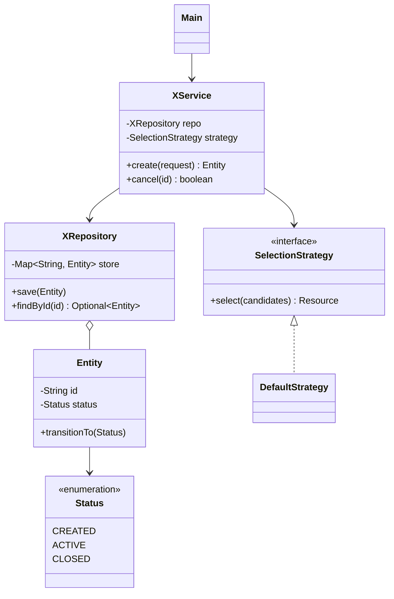

**Time split (45-60 min):** Requirements 5 | Entities + relationships 5-8 | Class diagram + APIs 10 | Code core flow 20-25 | Concurrency + extensibility 5 | Wrap-up 5

## 1. Requirements and Scope
- Ask clarifying questions first: who are the actors, what actions they take, what the limits are.
- **Functional requirements:** the 3-5 core use cases as verbs ("park vehicle", "book seat", "split expense"). List what is explicitly **out of scope**.
- **Non-functional requirements (LLD level):**
  - Single process, in-memory storage unless told otherwise
  - Thread safety: can two users act on the same object at once?
  - Extensibility: which parts are likely to change (pricing, strategy, new types)?
- Write 1-2 **example scenarios** (input -> expected output). They become the demo in `Main`.

## 2. Core Entities (Nouns)
- Pick nouns from the requirements: `ParkingLot`, `Floor`, `Spot`, `Vehicle`, `Ticket`.
- For each: key fields, which fields are `final` (identity) and which change (state).
- Mark **value objects** (`Location`, `Money`) vs **entities** with an ID (`User`, `Booking`).
- Use **enums** for fixed sets: `VehicleType`, `BookingStatus`, `SpotType`.

## 3. Relationships
- **Has-a (composition):** `ParkingLot` has `Floor`s; the child does not exist without the parent.
- **Uses (association):** `Ticket` refers to a `Spot`; both exist independently.
- **Is-a (inheritance / interface):** `Car`, `Bike` are `Vehicle`. Prefer interfaces + composition over deep inheritance.
- Multiplicity: 1:1, 1:N, M:N (M:N usually needs a join entity, e.g. `Booking` between `User` and `Show`).

## 4. Class Diagram and Public APIs
- **Mermaid class diagram goes here** (see template at the end).
- For each service class, list public methods with signatures and return types:
  - `Ticket park(Vehicle v)`, `Bill unpark(String ticketId)`
- Decide failure handling per method: return `boolean` / `Optional`, or throw a custom exception (`SpotNotAvailableException`).
- Validate inputs at the boundary (null, negative, out of range).

## 5. Layering (keep it simple)
| Layer | Role | Example |
|---|---|---|
| Model / entity | Data + its own rules | `Board.placePiece()`, `Spot.occupy()` |
| Repository / store | In-memory maps by ID | `Map<String, Booking>` |
| Service / manager | Use-case orchestration | `BookingService.book()` |
| Strategy / policy | Swappable algorithm | `PricingStrategy`, `WarehouseSelectionStrategy` |
| Driver | Demo of the scenarios | `Main` |

- Services call entity methods; they do not reach into entity internals.
- One service per use-case area; avoid one "God class" doing everything.

## 6. OOP and SOLID Checks
- **Encapsulation:** fields `private`; no getter that returns internal mutable state (arrays, lists). Return copies or unmodifiable views.
- **Tell, don't ask:** `board.placePiece(r, c, p)` instead of `board.getBoard()[r][c] = p`.
- **S:** each class has one reason to change (`Bill` calculates, `Printer` prints).
- **O:** add a new type/strategy by adding a class, not by editing `if/else` chains.
- **L:** subclasses work wherever the parent is expected (no `UnsupportedOperationException` overrides).
- **I:** small interfaces (`Payable`, `Refundable`) over one large one.
- **D:** services depend on interfaces, passed in through the constructor.

## 7. Design Patterns (use only when the problem asks for it)
| Problem signal | Pattern | Repo example |
|---|---|---|
| Algorithm varies (pricing, selection, splitting) | Strategy | `ParkingLot/PricingStrategy` |
| Behaviour depends on current state | State | `VendingMachine`, `ATM/State` |
| Notify many listeners on change | Observer | `CricBuzz/ScoreUpdateObserver` |
| Create objects by type | Factory | `Elevator/ElevatorCreator` |
| Many optional constructor params | Builder | `DesignPatterns/BuilderDesignPattern` |
| Request passes through handlers | Chain of Responsibility | `ATM/WithDrawlProcessor` |
| One shared instance (config, logger) | Singleton | `Logger` |
| Undo / queue actions | Command, Memento | `DesignPatterns/CommandDesignPattern` |
| Add behaviour without subclassing | Decorator | `DesignPatterns/DecoratorDesignPattern` |

Say **why** you picked a pattern and what would change without it.

## 8. Core Flow (code this first)
- Code the **happy path** of the main use case end to end before adding extras.
- Write it as numbered steps first, e.g. `book()`:
  1. Validate input
  2. Find available resource (strategy)
  3. Lock / reserve it
  4. Create the record (`Booking`, `Ticket`) and save it
  5. Return the result; release on failure
- Then add edge cases: not found, already taken, invalid state transition, limits reached.

## 9. Concurrency (when shared state exists)
- Find the **race**: two threads booking the same seat, two withdrawals from one account.
- Options, simplest first:
  - `synchronized` method or block on the shared object
  - `ReentrantLock` / `ReadWriteLock` (try-lock with timeout, read-heavy data)
  - `ConcurrentHashMap` + `computeIfAbsent` / `putIfAbsent` for atomic map updates
  - `AtomicInteger` / `AtomicLong` for counters and IDs
  - Optimistic check-and-set (version field) when conflicts are rare
- Lock the smallest scope possible; lock in a fixed order to avoid deadlocks.
- Producer-consumer: `BlockingQueue` (see `Threadpool`, `NotificationsSystem`).

## 10. Extensibility and Wrap-up
- Walk through 1-2 likely changes and show which class you would add or edit:
  - "Add electric vehicle spots" -> new `SpotType` + rule in the strategy
  - "Add weekend pricing" -> new `PricingStrategy` implementation
- Run the demo in `Main` with the scenarios from step 1.
- Mention what you would add with more time: persistence, tests, logging, metrics.

---

## Per-Design Checklist
- [ ] Clarified actors, use cases and out of scope
- [ ] Entities with fields, enums, IDs
- [ ] Relationships and multiplicity
- [ ] Class diagram drawn
- [ ] Public method signatures + failure handling
- [ ] Entities own their rules (no internal state leaked)
- [ ] Patterns justified, not forced
- [ ] Happy path coded and runnable
- [ ] Edge cases handled
- [ ] Races identified and handled
- [ ] Extensibility demonstrated with 1-2 changes
- [ ] Demo `Main` runs the scenarios

---

## Common Building Blocks (Class Diagram Template)
Reusable shell. Replace the names with the problem's entities.

